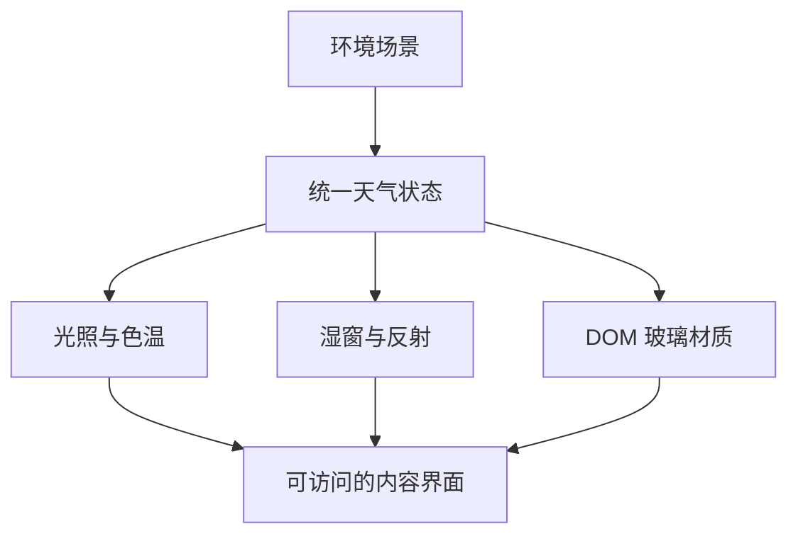

# JTY Home UI Design Notes

> 一份仅供阅读的前端设计案例：说明一套响应式水晶玻璃陪伴界面是怎样被组织和验证的，但不公开实现代码、精确参数、原始素材或后端。

**Design reference only · No source code · No backend**

这个仓库不是 JTY Home 的开源发行版，也不是可运行 Demo。它只记录设计目标、页面层级、环境状态、响应式取舍和质量检查方法。

## 为什么只公开设计参考

完整项目同时包含私人交互、服务端能力、数据结构和专用视觉实现。直接发布前端源码，会让界面被原样复制，也可能把本来不应公开的系统边界一并暴露。

因此这里采用“案例说明”的形式：把可以交流的设计方法写清楚，把实现本身留在私有项目中。

## 这里有什么

- 水晶玻璃视觉的目标与层级
- 晴光、持续雨、风暴三种环境状态的组织方式
- 桌面侧栏与手机底部导航的不同信息密度
- 首页、聊天、生活区、收藏区和样式台的职责划分
- WebGL、DOM 与 CSS 降级层之间的概念关系
- 性能、可访问性和公开发布前的检查清单

## 这里明确没有什么

- HTML、CSS、JavaScript、Shader 或可运行 Demo
- 后端源码、API 路由、数据库、鉴权或模型适配
- 精确颜色值、模糊半径、折射参数、断点或动画曲线
- 原始背景图、水滴纹理、字体文件、图标源文件
- 真实聊天、私人配置、人物资料或用户数据
- Service Worker、缓存清单或部署配置

## 设计的核心关系

文字、按钮和结构始终由 DOM 承载；天气与折射只负责环境，不把内容画进 Canvas。

## 设计原则摘要

1. **先有场景，再有玻璃。** 玻璃必须回应同一张环境，而不是叠一层与背景无关的白雾。
2. **清晰中心，厚度在边缘。** 可读性来自字重、对比和局部遮罩，不靠整卡磨砂。
3. **天气是状态系统。** 背景、色温、云层、路面反光、玻璃湿润和环境声共享同一状态。
4. **桌面和手机重新编排。** 手机不是把桌面卡片等比缩小，而是降低层级和入口数量。
5. **动效不能压过内容。** 雨滴透明、带轻高光、尺寸偏大但分布稀疏，画面保持安静。
6. **降级也必须忠于当前设计。** WebGL 不可用时仍使用当前场景，不能重新露出过期的处理图。

## 文档导航

- [视觉系统](docs/visual-system.md)
- [响应式页面结构](docs/responsive-structure.md)
- [天气与玻璃分层](docs/weather-and-glass.md)
- [公开边界](docs/release-boundary.md)
- [设计复查清单](docs/qa-checklist.md)

## 使用边界

本仓库用于阅读、讨论和引用设计思想，不授予复制 JTY Home 界面、视觉资产或私有实现的许可。完整条款见 [LICENSE.md](LICENSE.md)。

---

### English summary

This is a read-only design case study for a responsive crystal-glass companion interface. It explains the design goals, layer model, weather states, responsive composition, and review criteria. It contains no production source code, exact visual parameters, original assets, backend implementation, API surface, or user data.
