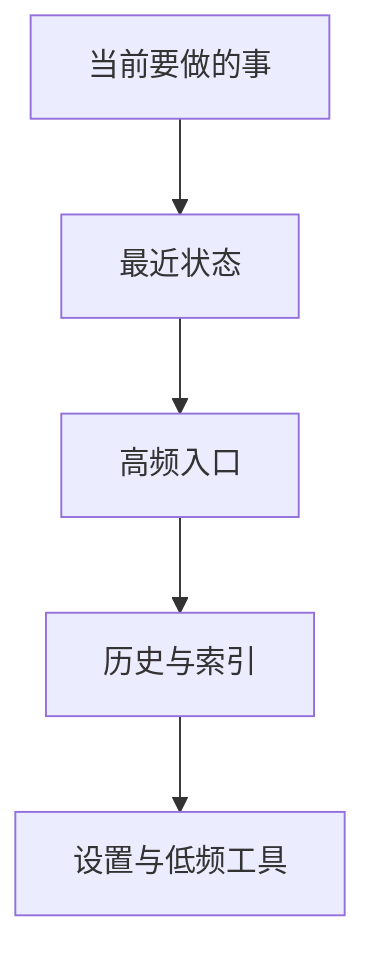

# 响应式页面结构

## 桌面与手机不是同一份布局的缩放

桌面有足够宽度同时保留空间感、最近房间和完整导航；手机则必须优先保证主任务、拇指可达性与纵向阅读。

| 功能 | 桌面 | 手机 |
| --- | --- | --- |
| 主导航 | 左侧常驻侧栏 | 底部五项导航 |
| 辅助入口 | 侧栏完整展示 | 顶部状态条与少量快捷入口 |
| 首页 | 主气泡 + 多列卡片 | 主气泡 + 低密度纵向卡片 |
| 生活区 | Bento 网格 | Today 总卡 + 2×2 高频入口 + 横向内容轨 |
| 聊天输入 | 宽输入区与辅助工具 | 紧贴安全区的单一主输入 |
| 次要设置 | 页面内完整分区 | 折叠到“更多”或样式台 |

## 信息优先级

手机端按照这个顺序从上到下排列。低频工具不能因为桌面有空间，就被原样塞到手机首屏。

## 首页

首页的任务不是展示所有功能，而是让用户在进入后立即知道三件事：

1. 这里仍然是同一个空间。
2. 最近有什么值得继续。
3. 下一步可以去哪里。

因此主视觉只保留一个明显焦点，其余内容通过章节、最近房间、未完事项和生活状态承接。

## 聊天

聊天视图应尽可能安静：

- 内容列宽限制在可阅读范围内
- 输入区始终靠近当前可视视口底部
- 手机软键盘出现时，不把消息区与导航同时顶乱
- 历史导航可以回到最前与最新位置，但不遮挡正文
- 附件、语音和资料入口属于辅助动作，不与发送按钮争夺视觉中心

## 生活区

生活区在手机端采用“今天先行”：

- 一张 Today 总卡汇总日期、待办、最近文字和共读进度
- 四个高频入口解决日记、待办、日历与便笺
- 共读和音乐用横向内容卡继续当前活动
- 健康、资料和设置进入折叠分组

桌面端则用 Bento 网格同时呈现更多模块，但仍通过面积和位置区分优先级。

## 安全区与触控

实现时需要单独验证：

- 顶部刘海与状态栏
- 底部 Home Indicator
- Safari 动态工具栏
- 软键盘打开、收起和返回缓存
- 小屏单手触控的点击区域

这些属于布局质量，不应当等到最后再补。
