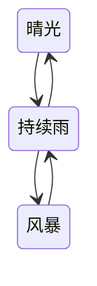
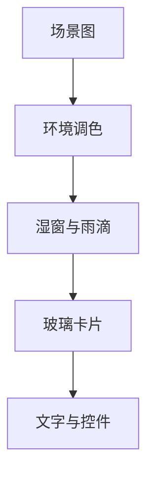

# 天气与玻璃分层

## 天气不是一层雨滴

天气状态同时影响场景曝光、色温、对比、云层、路面反光、玻璃湿润和可选环境声。雨滴只是其中一个结果。

只允许沿相邻状态变化，可以避免从明亮晴天直接跳到高对比风暴造成的视觉断裂。

## 五层职责

- **场景图**：桌面和手机使用各自构图。
- **环境调色**：统一控制晴雨色温、亮度和反射。
- **湿窗与雨滴**：位于 DOM 后方，只改变光学效果。
- **玻璃卡片**：使用同一环境建立厚度和层级。
- **文字与控件**：始终保持可访问的 DOM，不进入 Canvas。

## 持续雨的视觉约束

持续雨使用清晰的紫阳花街景作为构图基础，但原图不随本仓库公开。

雨滴需要满足：

- 无色透明，只有轻微中性高光
- 尺寸偏大但数量稀疏
- 不出现密集颗粒、强黑边或满屏雨丝
- 不用蓝灰雾遮住街景
- 只改变环境和折射，不盖住文字与按钮

目标是“窗外正在下小雨”，不是“屏幕上铺满水珠素材”。

## 晴光

晴天应直接使用干燥路径，不继续运行或上传雨水贴图。玻璃仍保留环境反射，但不制造湿润高光。

## 风暴

风暴可以提升云层、对比、反光和偶发闪光，但正文区域仍要稳定。闪电属于环境事件，不应让整页文字瞬间失去可读性。

## WebGL 与降级

WebGL 正常时，一个固定的全视口画布负责环境折射，避免每张卡片维护独立 Canvas。

WebGL 不可用、GPU 上下文丢失或页面尚未加载完成时：

- DOM 结构照常可用
- CSS 保留当前天气的光照与玻璃材质
- 降级背景必须与当前正式场景一致
- 不能重新引用已经废弃的处理图
- 缓存清单也必须同步删除旧素材

这条规则能避免偶尔重新出现旧雨景、灰尘感或错误背景。

## 性能原则

- 页面不可见时暂停持续动画
- 减少动态效果时关闭不必要的模拟
- 按视口面积限制内部水图预算
- 没有新水图帧时，不重复上传同一纹理
- 晴天不采样雨景和水图
- 只在尺寸或环境状态变化时重新计算玻璃对位

这些方法只描述方向；具体预算和实现参数不在公开范围内。
